# EventEase – Full Stack Event Management System

**EventEase** is a full-stack event management and booking platform built using the MERN stack. It provides a centralized platform for discovering events, managing event registrations, handling bookings, and overseeing event activities through separate user, organizer, and administrator dashboards.

---

## Table of Contents

- [Project Overview](#project-overview)
- [Features](#features)
- [User Roles](#user-roles)
- [Technology Stack](#technology-stack)
- [Application Screenshots](#application-screenshots)
- [Project Structure](#project-structure)
- [Installation and Setup](#installation-and-setup)
- [Environment Configuration](#environment-configuration)
- [Security](#security)
- [Author](#author)

---

## Project Overview

EventEase simplifies the process of organizing and participating in events.

The platform provides three role-based experiences:

- **Attendees** can discover events, book tickets, manage reservations, and access digital tickets.
- **Organizers** can create and manage events, monitor registrations, and view attendee information.
- **Administrators** can oversee platform activities, manage users, and review event and organizer approvals.

The application combines a responsive React frontend with a Node.js and Express backend, using MongoDB for data management.

## Features

### Authentication and Registration
- User registration and login.
- Separate attendee and organizer registration.
- JWT-based authentication.
- Role-based access to application dashboards.

### Event Discovery
- Browse available events.
- View event categories and details.
- Search and filter events.
- View event dates, venues, descriptions, and ticket prices.

### Event Booking and Tickets
- Book event tickets.
- Select ticket quantities.
- View booking history.
- Track booking status.
- Access digital tickets with QR codes.
- Print and download ticket information.

### Attendee Dashboard
- Personalized dashboard.
- View upcoming bookings.
- Manage reservations.
- Access digital tickets.
- Save events.
- Manage profile information.

### Organizer Dashboard
- Create and manage events.
- View event approval status.
- Monitor event statistics.
- Manage registered attendees.
- Search and filter attendee records.
- Export attendee information as CSV.

### Administrator Dashboard
- View platform statistics.
- Manage users.
- Review organizer applications.
- Approve or reject event submissions.
- Monitor platform activities.

---

## User Roles

| Role | Main Responsibilities |
|---|---|
| Attendee | Discover events, book tickets, manage bookings and access tickets |
| Organizer | Create events, manage submissions and monitor attendees |
| Administrator | Manage users, organizers, events and approvals |

---

## Technology Stack

| Component | Technologies |
|---|---|
| Frontend | React.js, Vite, JavaScript, CSS |
| Backend | Node.js, Express.js |
| Database | MongoDB, Mongoose |
| Authentication | JWT, bcrypt |
| API | REST API |
| Version Control | Git, GitHub |

---

## Application Screenshots

The following screenshots demonstrate the application's interface and its role-based functionality.

### 1. Authentication and Registration

**Login Page**

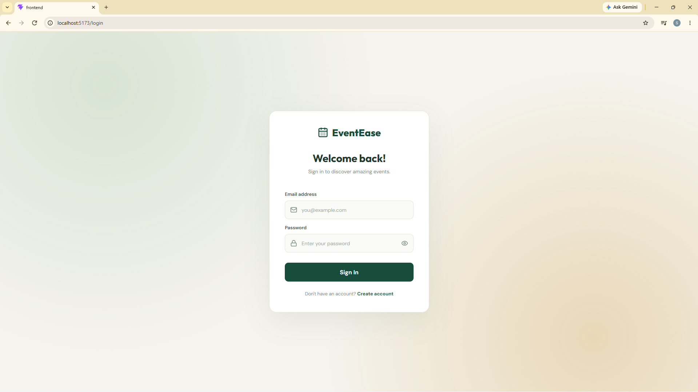

**Attendee Registration**

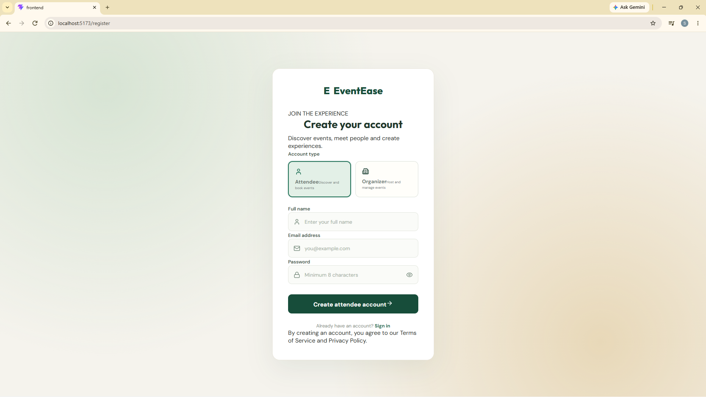

**Organizer Registration**

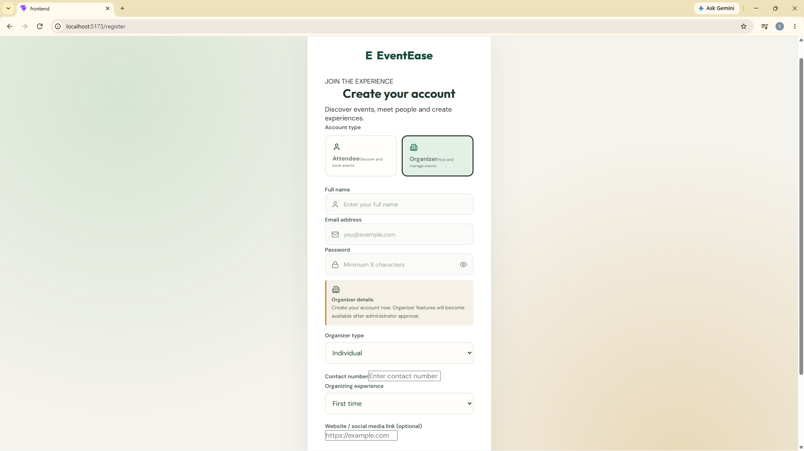

### 2. Event Discovery and Booking

**EventEase Home Page**

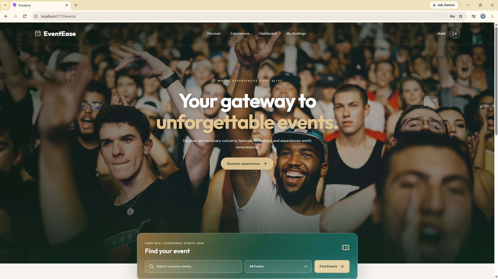

**Explore Events**

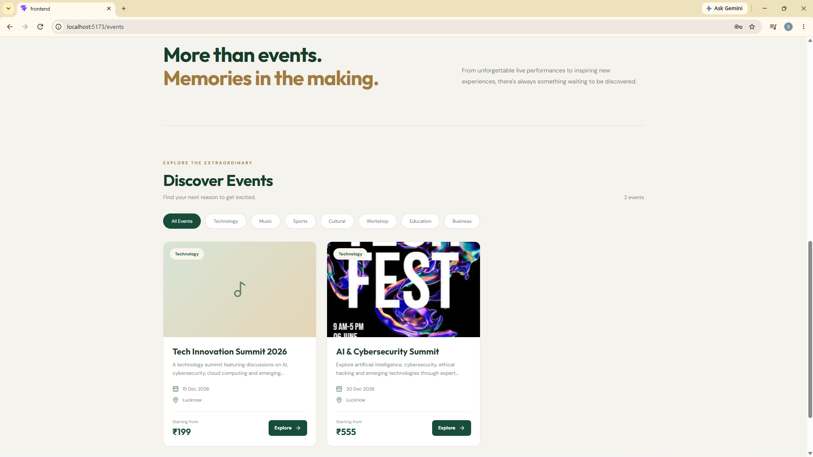

**Event Details and Ticket Booking**

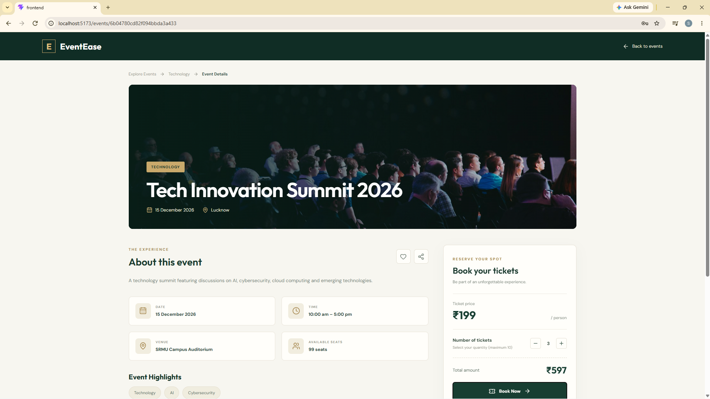

### 3. Attendee Dashboard

**User Dashboard**

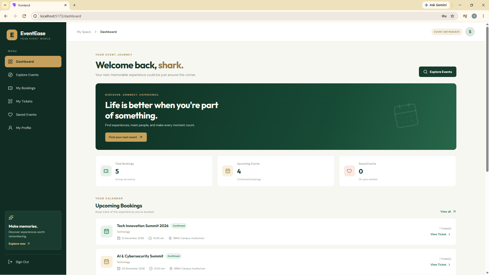

**My Bookings**

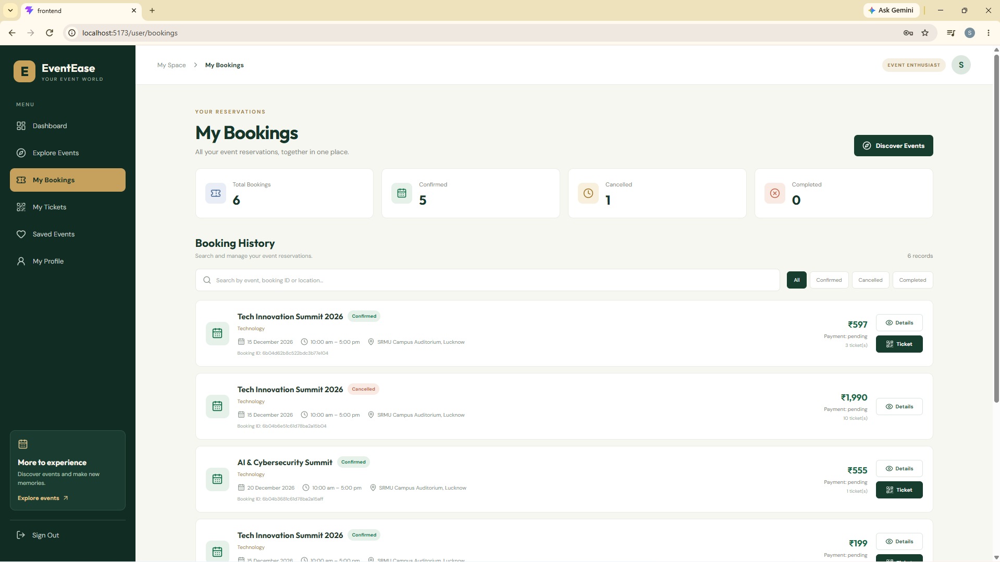

### 4. Organizer Dashboard

**Organizer Overview**

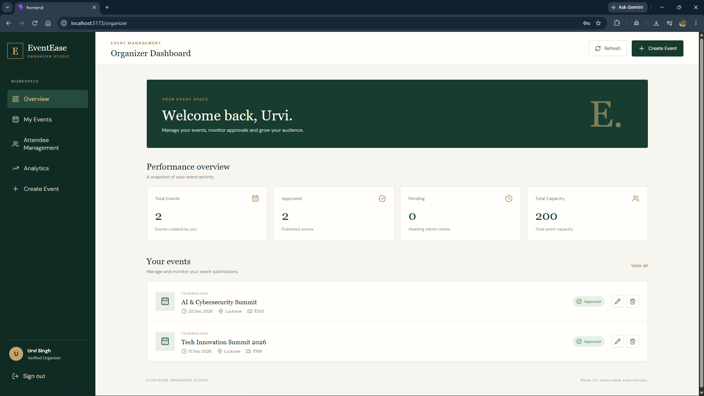

**My Events**

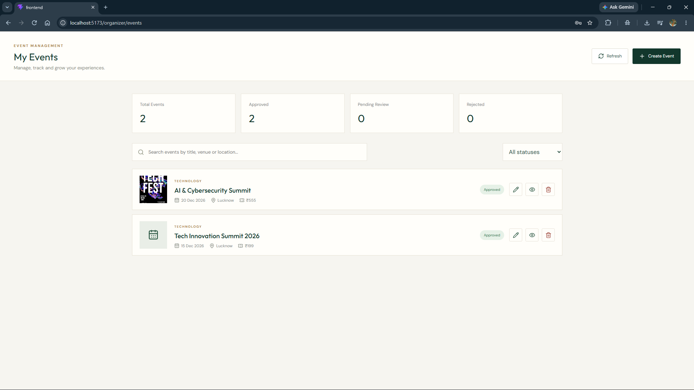

### 5. Administrator Dashboard

**Administration Panel**

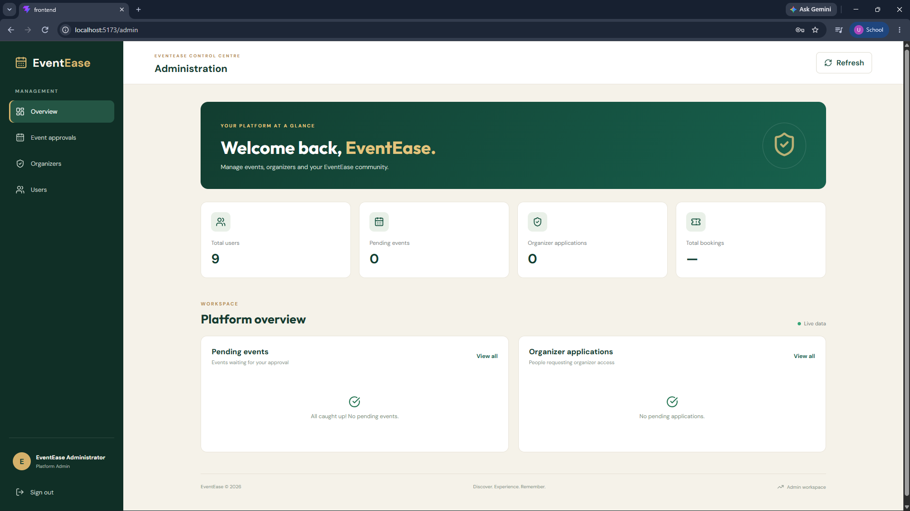

---

## Project Structure

```text
eventmnager/
│
├── backend/
│   ├── controllers/
│   ├── models/
│   ├── routes/
│   ├── middlewares/
│   ├── config/
│   ├── uploads/
│   ├── server.js
│   └── package.json
│
├── frontend/
│   ├── public/
│   ├── src/
│   ├── index.html
│   └── package.json
│
└── README.md
```

## Installation and Setup

### Prerequisites

Install the following before running the application:

- Node.js
- npm
- MongoDB or MongoDB Atlas
- Git

### 1. Clone the Repository

```bash
git clone https://github.com/phenomenalforeveryone/eventmnager.git
```

```bash
cd eventmnager
```

### 2. Install Backend Dependencies

```bash
cd backend
npm install
```

Configure the backend environment variables in a `.env` file.

Start the backend using the development script configured in `backend/package.json`:

```bash
npm run dev
```

### 3. Install Frontend Dependencies

Open a second terminal:

```bash
cd frontend
npm install
```

Configure the frontend environment variable:

```env
VITE_API_URL=http://localhost:5000/api
```

Start the frontend:

```bash
npm run dev
```

### 4. Open the Application

Open the local URL displayed by Vite in your browser. The default frontend address is:

```text
http://localhost:5173
```

Keep both backend and frontend terminals running while using the application.

---

## Environment Configuration

The application uses environment variables for configuration.

Configure the required variables in the backend `.env` file, including:

- MongoDB connection string.
- JWT secret.
- Backend port.
- Frontend client URL, if required by the backend.

The frontend uses:

- `VITE_API_URL` – Backend API base URL.

**Security note:** Actual credentials and secret values must never be committed to GitHub. Use `.env.example` files to document required variable names.

---

## Security

The application uses:

- Password hashing with bcrypt.
- JWT-based authentication.
- Role-based authorization.
- Protected application routes.
- Environment variables for sensitive configuration.

---

## Author

**Urvi Singh**

B.Tech – Computer Science and Engineering

**Project Name:** EventEase  
**Project Category:** Full Stack Web Development  
**Technology:** MERN Stack

**GitHub Repository:**  
https://github.com/phenomenalforeveryone/eventmnager

---

*EventEase – Discover. Experience. Remember.*
